  

  

---

## 🧭 Sobre mim

Sou estudante de **Sistemas de Informação** na UNIPAR, em **Paranavaí – PR**, e desenvolvedor full stack com foco em **Java/Spring Boot no backend**, **React no web** e **Flutter no mobile**.

O que me move é fazer software que funciona no chão da operação. Meu projeto principal controla o **fluxo de caminhões em pátios de carga e descarga**: fila, romaneio, painel de chamadas na TV, senha impressa na térmica e checklist no celular — tudo conversando em tempo real e integrado ao ERP. Para isso funcionar, não basta o código: também configuro a **rede, o servidor e os kiosks** onde ele roda.

🐛 Criando bugs desde 2019 — e aprendendo com cada um deles.

---

## 🛠️ Stack

| Camada | Tecnologias |
|:--|:--|
| **Backend** |       |
| **Dados** |      |
| **Frontend e mobile** |      |
| **Integrações** |      |
| **Entrega** |     |
| **Infra e redes** |      |

---

## 🚀 Projetos

> A maioria tem código fechado, então aqui conto o que cada um resolve e como foi construído.

### 🚛 MPG Pátio — Gestão de pátio de caminhões

Controle do fluxo de caminhões em operações de carga e descarga, da chegada na portaria até a liberação.

| Módulo | O que resolve |
|:--|:--|
| **Fila** | Entrada, ordem de atendimento e chamada dos motoristas |
| **Painel de chamadas** | Painel em TV atualizado em tempo real via WebSocket |
| **Senhas** | Impressão em impressoras térmicas a partir de kiosks Linux |
| **Romaneios** | Registro das operações de carga e descarga |
| **Integrações** | Sincronização com ERP e avisos por WhatsApp |
| **Checklist mobile** | App Flutter que funciona **offline** e sincroniza quando a conexão volta |

`Java` `Spring Boot` `React` `Flutter` `PostgreSQL` `Redis` `WebSocket` `Docker`

### 🧠 SIGAPSI — TCC

Sistema Integrado de Gestão e Atendimento Psicológico.

| Módulo | O que resolve |
|:--|:--|
| **Agenda** | Agendamento de atendimentos |
| **Prontuário** | Registro e histórico de atendimentos por paciente |
| **Financeiro** | Controle de pagamentos das sessões |
| **Acesso** | Controle por perfil e atenção ao sigilo das informações clínicas |

### ✍️ MPG Assinatura

Fluxos de assinatura digital de documentos, com frontend, backend e implantação em Docker.

### 🖥️ MPG Support *(em desenvolvimento)*

Central de suporte e monitoramento de dispositivos: indicadores de CPU, memória e rede, captura de tela e ações remotas para diagnóstico.

---

## 💡 O que eu já resolvi na prática

- 🔐 **Segurança de API** — autenticação com JWT e Spring Security, com controle de acesso por perfil
- 🗄️ **Banco versionado e auditável** — migrações com Flyway e histórico de alterações com Hibernate Envers
- ⚡ **Tempo real** — painéis de chamada atualizados via WebSocket, com Redis de apoio
- 📱 **Mobile offline-first** — checklist em Flutter que continua funcionando sem rede e sincroniza depois
- 🔌 **Integração com o mundo físico** — impressoras térmicas, kiosks Linux e painéis de TV na operação
- 🔗 **Integrações** — ERP, WhatsApp, webhooks e automações com n8n
- 🌐 **Infra que sustenta o sistema** — redes MikroTik/Ubiquiti com VLANs, QoS e VPN WireGuard, servidores Linux com Docker e exposição segura com Cloudflare Tunnels e Zero Trust

---

## 📊 Números

  

  <picture>
    <source media="(prefers-color-scheme: dark)" srcset="https://raw.githubusercontent.com/matheeuszoka/matheeuszoka/output/github-snake-dark.svg" />
    <source media="(prefers-color-scheme: light)" srcset="https://raw.githubusercontent.com/matheeuszoka/matheeuszoka/output/github-snake.svg" />
    
  </picture>

---

## 🎓 Formação e certificações

**Bacharelado em Sistemas de Informação** — UNIPAR · Paranavaí – PR

**MikroTik Certified Network Associate (MTCNA)**

---

**Bora conversar?** Se o assunto for API, integração, automação ou rede, é comigo mesmo.

Sempre tem algo novo para aprender, construir ou depurar.

